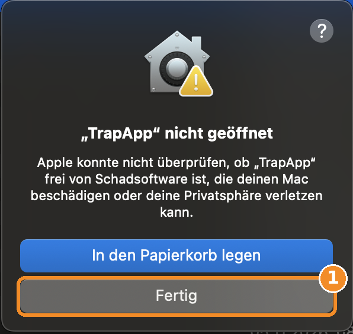
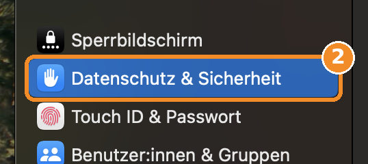
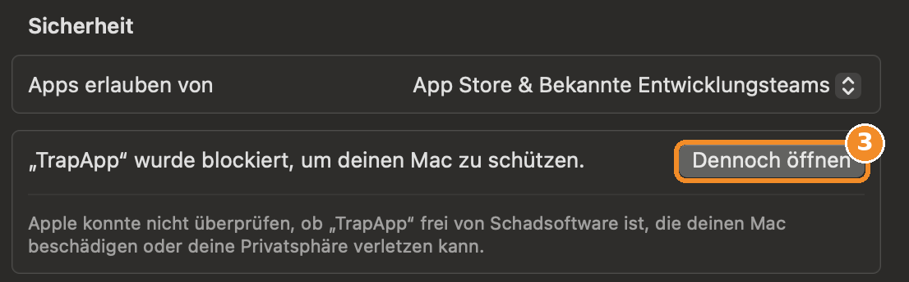
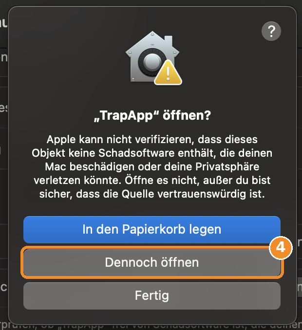
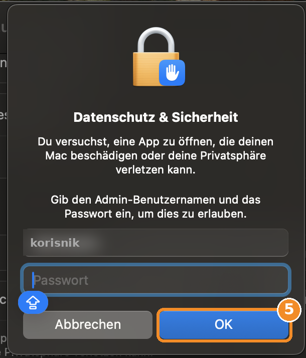
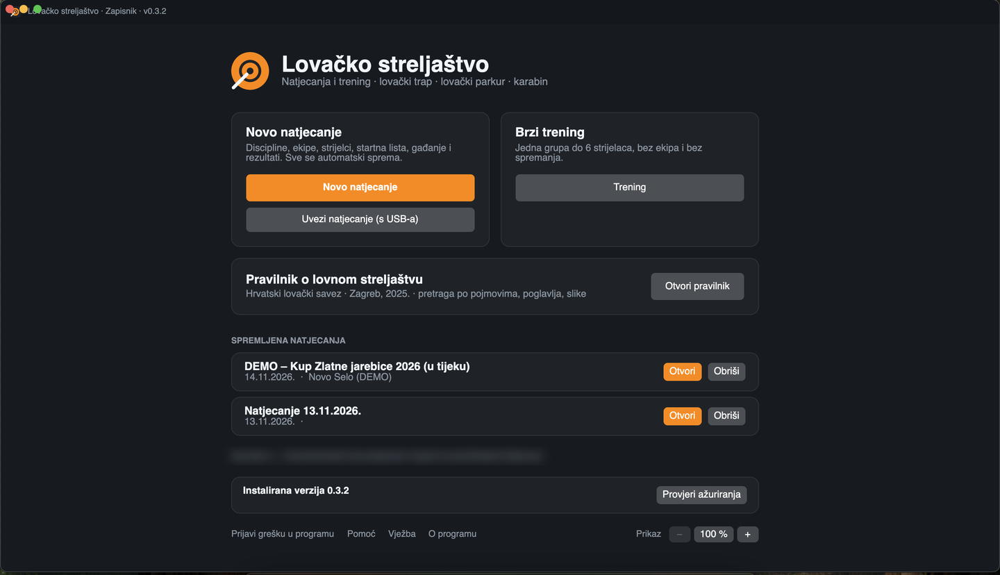

# Lovačko streljaštvo – zapisnik

Program za natjecanja i trening u lovnom streljaštvu (lovački trap, lovački parkur, karabin) prema Pravilniku HLS-a.
Za **Windows 10 i 11** i za **Mac** (macOS 14 ili noviji – probna verzija).

## ⬇️ Preuzimanje

**[Preuzmi TrapApp-win-Setup.exe](https://github.com/daxemann/trapapp-releases/releases/latest/download/TrapApp-win-Setup.exe)** (uvijek najnovija verzija)

Sve verzije i popis promjena: [Releases](https://github.com/daxemann/trapapp-releases/releases)

### 🍎 Mac – probna verzija

| Vaš Mac (jabuka → „O ovom Macu“) | Preuzimanje |
|---|---|
| Čip **Apple M1, M2, M3, M4 …** (gotovo svi od 2021.) | **[TrapApp-0.3.2-mac-applesilicon.zip](https://github.com/daxemann/trapapp-releases/releases/download/mac-0.3.2-test/TrapApp-0.3.2-mac-applesilicon.zip)** |
| Procesor **Intel** | **[TrapApp-0.3.2-mac-intel.zip](https://github.com/daxemann/trapapp-releases/releases/download/mac-0.3.2-test/TrapApp-0.3.2-mac-intel.zip)** |

📄 **[Upute: Prvo pokretanje na Macu (PDF)](https://github.com/daxemann/trapapp-releases/releases/download/mac-0.3.2-test/Prvo-pokretanje-na-Macu.pdf)** · [Stranica izdanja](https://github.com/daxemann/trapapp-releases/releases/tag/mac-0.3.2-test)

> ⚠️ Mac verzija je **probna**: Intel Mac je ispitan, Mac s čipom Apple M još nije.

---

## Instalacija (Windows)

1. Preuzmite datoteku **TrapApp-win-Setup.exe** (poveznica gore).
2. Pokrenite je dvostrukim klikom.
3. **Pojavit će se plavi prozor sustava Windows** (SmartScreen):

   > **Windows je zaštitio vaše računalo** *(njem. „Der Computer wurde durch Windows geschützt“)*

   To je **normalno** i ne znači da je program opasan. Windows ovo prikazuje za svaki program koji nije potpisan skupim komercijalnim certifikatom.

4. Kliknite na poveznicu **„Više informacija“** ispod teksta *(njem. „Weitere Informationen“)*.
5. Dolje se pojavi gumb **„Svejedno pokreni“** – kliknite ga *(njem. „Trotzdem ausführen“)*.
6. Instalacija traje nekoliko sekundi, bez dodatnih pitanja i bez administratorskih prava. Program se zatim sam pokrene.

Program se nalazi u izborniku **Start** pod nazivom **„Lovacko streljastvo“**.

> ℹ️ Plavi prozor pojavljuje se **samo jednom**, kod prve instalacije. Ažuriranja ga više ne prikazuju.

### Instalacija s USB sticka

Ako datoteku **TrapApp-win-Setup.exe** kopirate na USB stick i pokrenete je s njega na drugom računalu, plavi prozor se u pravilu ne pojavljuje.

### Instalacija na Macu

1. Preuzmite odgovarajuću **.zip** datoteku (tablica gore) i dvaput kliknite na nju → pojavi se **TrapApp**.
2. Povucite **TrapApp** u mapu **Aplikacije / Programi**.
3. **Prvo pokretanje (samo jednom)** – macOS ga blokira jer program nije iz App Storea. To je normalno.

*Slike su s njemačkog macOS-a – na hrvatskom ili engleskom gumbi su na istom mjestu.*

| | |
|---|---|
| **1.** Dvaput kliknite na TrapApp → kliknite **„Gotovo“** *(Fertig / Done)* – ne „Premjesti u smeće“. |  |
| **2.** Jabuka → **Postavke sustava → Privatnost i sigurnost** *(Datenschutz & Sicherheit / Privacy & Security)*. |  |
| **3.** Dolje kod „Sigurnost“: „TrapApp je blokiran …“ → **„Svejedno otvori“** *(Dennoch öffnen / Open Anyway)*. |  |
| **4.** Pitanje „Otvoriti TrapApp?“ → ponovno **„Svejedno otvori“**. |  |
| **5.** Lozinka Maca → **OK**. |  |
| **6.** TrapApp se pokrene – od sada normalno dvostrukim klikom. |  |

> ℹ️ „Svejedno otvori“ vrijedi **samo za TrapApp** – zaštita Maca za sve ostale programe ostaje uključena, ništa ne treba vraćati. S USB sticka se poruka najčešće uopće ne pojavi.

Detaljno s objašnjenjima: **[Prvo-pokretanje-na-Macu.pdf](https://github.com/daxemann/trapapp-releases/releases/download/mac-0.3.2-test/Prvo-pokretanje-na-Macu.pdf)**

---

## Ažuriranja

**Windows:**

- Program kod svakog pokretanja sam provjerava postoji li nova verzija (potreban je internet).
- Ako postoji, na početnoj stranici pojavi se narančasti okvir **„Dostupna je nova verzija …“** s opisom promjena.
- Kliknite **„Preuzmi i ažuriraj“** → program preuzme novu verziju i ponovno se pokrene.
- Dok je natjecanje otvoreno, ažuriranje nije moguće (prvo zatvorite natjecanje).
- Ručna provjera: početna stranica, dolje → **„Provjeri ažuriranja“**.
- Instalirana verzija vidi se na početnoj stranici dolje i u naslovu prozora (npr. *v0.1.1*).

**Mac:** zasad ručno – preuzmite novu .zip datoteku i zamijenite TrapApp u mapi Aplikacije. Podaci ostaju sačuvani.

## Podaci

Natjecanja se automatski spremaju u mapu:

- **Windows:**

```
%LOCALAPPDATA%\LovackoStreljastvo\Natjecanja
```

- **Mac:**

```
~/Library/Application Support/LovackoStreljastvo/Natjecanja
```

Podaci **ostaju sačuvani** kod ažuriranja, deinstalacije i ponovne instalacije.

## Deinstalacija

**Windows:** Postavke sustava Windows → **Aplikacije** → **„Lovacko streljastvo“** → **Deinstaliraj**.

**Mac:** povucite **TrapApp** iz mape Aplikacije u Smeće.
